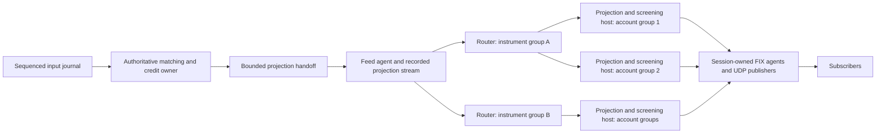

# Distributed screened market data: design and implementation plan

Proposed 2026-11-08. This develops solution 1: a distributed market-data service driven by authoritative book and credit changes. It is a design proposal, not an implemented capability or a capacity claim.

The target is to distribute projection maintenance, account screening, encoding and delivery across cores and machines. Matching and live credit accounting retain one authoritative owner. Adding market-data subscribers must not add matching work or synchronous network calls to that owner.

This document expands M6 and the market-data part of M7 in [PLAN.md](../PLAN.md). The existing trading, identity, durability and lifecycle milestones still apply. Production scope initially follows that plan's SPOT restriction; SWAP and NDF require their outstanding economics decisions.

**1. Evidence and acceptance envelope**

The current [MarketDataService](../clob-marketdata/src/main/java/clob/marketdata/MarketDataService.java) replays a complete matching engine and performs every instrument's screening and handoff in its input callback. [FixGateway](../clob-fix/src/main/java/clob/fix/FixGateway.java) provides one encoding and socket agent, and both its market-data ring and [Pipeline](../clob-sequencer/src/main/java/clob/sequencer/Pipeline.java) followers spin when full. [Recorded results](../clob-bench/SPIKE-RESULTS.md) show a 22.9 ms median cycle for 200 books and 64 screened subscribers per book on the development machine. The benchmark sink counts publications; it does not encode FIX or measure receiver delivery.

[Requirements §9–11](../requirements.md) specify a common cycle cut, headroom-aware screening, rotating subscriber order, 200 instruments and 10,000 updates/second per instrument. Subscriber counts, aggregate peak, receiver/network envelope and overload policy remain open under D8. Use the following as an engineering test matrix until those business numbers are supplied:

| Dimension | Proposed exploration; not an agreed commitment |
|---|---|
| Instruments and input load | 200 instruments; exercise all peaking together at 2M inputs/second, plus skew to a hot instrument. Record the actual input/update definition. |
| Accounts and subscriptions | 256, 1,024 and 4,096 distinct screening accounts; 64, 256 and 1,000 subscriptions per instrument. Distinguish accounts from multiple sessions subscribing for the same account. |
| Cycle and depth | 5 ms example interval; top of book and configured maximum depth; mixed valid instrument intervals. |
| Books | Explicit order-count, price-level and counterparty limits; shallow and deep books, all changed and unchanged, plus bursts. |
| Credit | Relationship overrides, shared pools, signed NOP in both directions, exhausted and reducing-only pools, many dates, rate/date changes and fixing reservations. |
| Deployment | 1, 2, 4, 8 and 16 screening cores; 1, 2 and 4 worker hosts. Separate generators and receivers from service hosts. |

M6 acceptance requires a signed-off envelope, including receiver clock accuracy, delivery deadline, permitted misses and burst duration. Functional work and scaling experiments can proceed while those numbers are being agreed.

**2. Target data flow and ownership**

The picture shows logical roles. Several roles can share a process initially; their queue, ownership and recovery contracts remain the same when moved onto separate hosts. Router lanes and publisher agents are partitioned resources, not single fleet-wide agents.

| Component | Owns | Execution and scaling |
|---|---|---|
| Matching and credit owner | Orders, execution priority, real usage, timers and trading decisions | Existing single writer. Emits primitive projection changes with bounded handoff attempts. |
| Feed agent/recorder | Projection encoding, live transport and recorded positions | Runs off the engine thread. Its source throughput and storage capacity are measured separately. |
| Router lane | An instrument group, routing dependencies and downstream watermarks | Multiple lanes process/filter the source stream independently. They perform no matching. |
| Projection owner | Displayed orders for assigned instruments, required credit/reference state and immutable cycle generations | One writer per local projection; repeat an instrument projection on additional hosts when account groups require it. |
| Screening worker | Assigned account views, sparse hypothetical credit usage and reusable buffers | Dedicated cores. Jobs are independent by instrument, account and side. |
| Delivery agent | FIX session state, encoder, resend state and sockets, or UDP endpoints and sequences | Single owner per FIX session; many agents and hosts. |
| Control service | Subscription membership, route versions, worker assignments and publication ownership | Durable configuration off the trading path. Changes take effect at explicit cycle boundaries. |

The matching owner and canonical source remain serial resources. This project scales market-data work; benchmark feed capture and source amplification to establish the remaining ceiling.

Start the control role as one active service with a durable log and operator-fenced failover, consistent with the current manual-failover scope. Cache its versioned decisions at routers and publishers; no per-view remote lookup or consensus round sits on the cycle path.

**3. Authoritative projection protocol**

Add pure domain observer interfaces in the engine and credit modules, separate from execution reports. The current [EngineListener](../clob-engine/src/main/java/clob/engine/EngineListener.java) does not carry enough information to reconstruct displayed state or pool usage.

Use a versioned binary schema with stable message and enum IDs, explicit lengths, bounds checks and a configuration manifest. Proposed implementation: generated [SBE codecs](https://aeron.io/docs/simple-binary-encoding/basic-sample/) and Agrona buffers, with no codec or transport dependency inside matching algorithms.

Each source record carries a history ID, authority term, feed generation, input sequence and event ordinal. The history ID identifies the input-journal lineage; a fenced primary promotion changes the authority term; a feed rebuild can change the feed generation without pretending trading history changed. Bind schema, refdata, credit-rules version, seed and capacity assumptions in the manifest.

| Record | Required content and purpose |
|---|---|
| InputBegin / InputEnd | Input sequence, record count and integrity check. End marks a complete application, including any timers fired before the command. Emit completion even when no projection state changed. |
| DisplayedOrderUpsert | Order ID, instrument, account, side, raw price ticks, displayed quantity and priority sequence. This is the complete displayed after-state for that order. |
| DisplayedOrderDelete | Order ID and instrument. Covers fills, cancels, expiry, suspension and moves out of the displayed book. |
| PoolState | Pool ID, owner identity, type, exact limit, signed net total and revision. Ownership must support the entity model planned in M3. |
| PoolDateUsage / PoolDateDelete | Pool/date key and absolute gross/net usage, or deletion. Preserve exact fixed-point units and all still-open dates required for recovery. |
| RelationshipState | Both directed relationships remain distinct; include default and instrument overrides, removal and pool mapping. |
| ReferenceState / InstrumentState | USD rates, value dates, entity mappings, configuration versions and halt/session state used by screening. |
| CycleCut | Scheduled boundary, cycle ID, completed input sequence and source position. Emitted after all effects of the corresponding MD_TICK input. |
| Manifest / checkpoint records | Compatible schema/configuration identity, complete cut and integrity metadata for bootstrap and replay. |

After-state records make replay idempotent by source position and support downstream coalescing. A router may retain only the latest update for a key within a cycle, provided it preserves deletes, membership changes and every retained cut; it may not coalesce across an observable cut.

Capture changes at the actual mutation paths: resting insertion/removal, visible fills, iceberg refresh and priority loss, amendments, peg suspension/resumption/reprice, race application, expiry, mass cancel, end of day and session transitions. Capture tombstones before pooled order objects can be reused. Avoid a full book scan after each input.

Credit observers fire on real committed changes, including mid trades, fixing reservations, settlement roll, limits and relationships. FOK simulation and market-data simulations emit no authoritative changes. Pricing an already-reserved fixing match must not consume credit again.

Wrap dispatch with batch begin/end so timer effects and command effects belong to the same completed input. A rejected command may still have preceding timer effects. Unexpected exceptions or a failed handoff invalidate the batch; they never produce a successful InputEnd. Upstream credit failure atomicity remains a production prerequisite.

Advance the applied input watermark only at InputEnd. Consumers may stage mutations earlier, but an incomplete batch cannot enter a checkpoint or a frozen cut; on failure discard its staging state or rebuild the affected generation. CycleCut follows the completed tick batch.

**4. Handoff, recording and overload**

Give the engine one preallocated single-producer handoff to the feed agent. Each observer performs a bounded write attempt with reusable scratch storage. No filesystem access, socket access, subscriber loop, waiting for an acknowledgement or retry-until-success loop occurs on the matching thread.

There is an unavoidable trade-off: a finite handoff cannot remain lossless under an indefinitely stalled recorder while matching continues. The proposed policy preserves matching progress and explicitly makes market data unavailable until repaired:

1. On the first failed write, latch the feed generation as invalid and record the last complete input. Further projection capture for that generation becomes a cheap disabled path.
2. Publish the invalid state through an independent health/control signal, since the full data queue cannot be relied on to carry its own failure message.
3. Downstream consumers discard any incomplete batch. Publication gates reject invalid generations and missing/late cuts; heartbeat deadlines also handle a dead source or broken control path.
4. Restore a valid generation from a compatible checkpoint and deterministic input replay on a recovery process. Matching never waits for that recovery.
5. If recovery cannot outrun input, keep the affected feed unavailable, add recovery capacity or take a coordinated checkpoint. Never relabel lagging state as the current boundary.

The input journal is the recovery authority; the recorded projection stream accelerates catch-up. Require M2's replay manifest, retained input coverage and M5's corruption/durability contract. Feed recovery may rerun matching off the trading host; ordinary projection workers do not. Obtain checkpoint state by replay or a bounded, versioned snapshot mechanism.

Define a replay/live splice at a completed input S. Buffer/record a candidate generation's live suffix from S+1 while a recovery process builds state through S. Activate only after that prefix and suffix form a verified contiguous history. Bound the suffix buffer and restart recovery if it overflows; never switch by approximate timestamps.

A checkpoint contains displayed orders and priority, complete required pool/date and relationship state, reference/entity state, source cut and manifest identity. Publish its completion manifest only after its contents pass integrity validation under the selected persistence policy. Retain the corresponding projection/input suffixes for the agreed recovery window. A worker older than retention must take a fresh snapshot; one failed worker cannot force unlimited retention.

Use [Aeron publications/subscriptions](https://aeron.io/docs/aeron/publications-subscriptions/) between processes/hosts and [Archive](https://aeron.io/docs/aeron-archive/overview/) for recorded projection replay. The feed agent handles source-transport backpressure; downstream agents own their respective overflow and recovery policies. Configure live consumer isolation deliberately: [minimum flow control](https://aeron.io/docs/aeron/multi-destination-cast/#flow-control) allows the slowest receiver to constrain publication. A lagging optional worker leaves the live path and recovers from recording or checkpoint. Archive recording does not, by itself, settle the input acknowledgement or power-loss durability contract.

All queues, record assembly, retained generations, resend stores and recovery buffers have explicit limits. Healthy capacity must cover the admitted envelope; the unavailable/resync path is a fault policy, not a successful deadline outcome. Reject additional subscriptions before admitting work beyond measured CPU or network capacity.

**5. Partitioning, dependencies and cycle cuts**

Use a logical partition key of instrument group and screening-account group. Physical placement is configuration, not a hash embedded in event identities. One instrument can span many account groups; adding instruments can add independent instrument groups.

Within a host, share one immutable instrument projection among several account workers. Across hosts serving the same instrument, replicate its displayed-order changes. Co-locate multiple subscriptions for the same account view where practical, then fan out the result. FIX sessions retain one owner even when their instruments are calculated on different hosts.

Route displayed-order changes to hosts serving that instrument. Route credit usage by the pools their subscribed accounts can depend on, in both relationship directions. A trade on instrument A can invalidate a view on instrument B through a shared pool, even if B's book has not changed. Hidden/mid/fixing activity can have the same effect through credit usage.

Maintain reverse dependencies from pool, relationship, entity, rate and value date to affected account/instrument views. New counterparties entering a displayed book, new relationships, new overrides and pool remapping must update those dependencies before the next cut. Bootstrap newly required state at the same source cut before considering a subscription ready.

For the correctness baseline, broadcast credit changes to each instrument router and verify selective routing against that baseline. The target uses dependency routing to reduce downstream work. A broad shared pool genuinely has broad fanout; include that case in acceptance rather than assuming dependencies are sparse. Initial routers still read the canonical source rate, which is an explicit throughput limit to measure.

Filtered streams use contiguous local route positions plus an upstream watermark. A missing upstream input number is not evidence of loss when filtering intentionally omitted it. A router forwards a cut only after it has consumed the source through that cut and forwarded every relevant committed change ahead of the marker.

For each cycle:

1. The sequencer journals MD_TICK on the agreed wall-clock grid. Validate instrument intervals against this grid. Marker lateness and skipped boundaries are recorded as deadline failures.
2. The matching owner applies the tick, including due timers, completes the input batch and emits CycleCut.
3. Routers deliver all relevant book, credit and reference changes through that cut, followed by their route markers.
4. A projection owner freezes a generation only after every required route has reached the same source cut. Matching a wall-clock timestamp or a transport position alone is insufficient.
5. A cycle manifest binds source cut, scheduled boundary, subscription-control version and route version. Changes arriving during a cycle apply to a later manifest.
6. Screening jobs use that immutable generation. Later source inputs are applied to a separate generation using copy-on-write or bounded versioned pages. Buffer recycling waits for readers; a stalled reader exhausts its allowance and loses readiness rather than retaining unbounded history.

Keep the current single authoritative input sequence as the cut identifier. If matching is sharded in a future project, extend the cut to a coordinated sequence vector; independent per-book timestamps cannot replace it.

**6. Headroom-aware screening**

Extract pure credit arithmetic into shared credit rules used by both the authoritative engine and the screening evaluator. Expose read-only pool/reference state and a worker-owned overlay; do not run the existing mutable CreditEngine simulation concurrently.

The proposed calculation is a displayed-liquidity ladder, independently for each account, instrument and side. It shares no hypothetical usage with other accounts or instruments and reserves no real credit. Several instruments can therefore advertise alternatives against the same pool; the feed does not promise that all alternatives remain simultaneously executable.

For each view:

1. Read displayed orders in raw price/time priority, retaining account and pool identity until credit clipping has completed. Do not first aggregate different counterparties into a price bucket.
2. Evaluate bids with the subscriber selling and offers with the subscriber buying. Resolve both credit directions, entity restrictions, instrument/date mapping, USD rate and signed NOP direction at the cut.
3. Clip each eligible displayed quantity against both pools, including hypothetical usage already consumed by earlier displayed orders in this view. Round every hypothetical fill to the instrument's valid execution size.
4. Update only the private sparse overlay for the pools/dates touched. Reset the overlay between sides and between views.
5. Aggregate the resulting quantities into market-data price buckets: bids down, offers up. Stop once the requested maximum depth is complete, retaining enough state to fill deeper buckets when a better level disappears.
6. Build once per account at the required maximum depth, then truncate for individual depth subscriptions and suppress unchanged content using exact comparison or verified version dependencies.

A 10m pool shared by three 10m displayed orders contributes at most 10m across that side's hypothetical ladder. Trades on another instrument can reduce that contribution without any order change here. FX-rate changes alter new-trade capacity without revaluing previously recorded usage.

Define and approve the precise relationship between this displayed ladder and a full execution simulation before production. Hidden liquidity, iceberg replenishment and self-trade cancellation barriers can make a real IOC sweep differ from a displayed-only ladder. The proposed baseline excludes hidden/reserve quantities and same-entity liquidity; if §9 requires literal full-sweep executability, specify those interactions and extend the private projection/oracle accordingly. Do not silently equate the two contracts.

Begin with one calculation per account. Share calculations between different accounts only when their full relevant credit, ownership and reference state proves equivalence. Identical eligibility bits are insufficient. Replace the current global configuration-version cache with dependency revisions covering trades, reservations, rolls, rates, dates and ownership changes.

Incremental work proceeds in two steps: maintain raw projections from deltas and rebuild only dirty account views at a cut; then add finer bucket/pool contribution caching where profiles justify it. A headroom change can redistribute liquidity across multiple deeper levels, so updating only the directly changed bucket is unsafe.

**7. Delivery, subscriber rotation and recovery**

Create a subscription control log with stable subscription IDs, authorized account, instrument, depth, transport, effective cycle and owner. Freeze membership and its stable ordering in the cycle manifest. A late join receives a full snapshot at a complete cut before entering subsequent cycles; an unsubscribe or revoked session is also checked at the delivery owner.

Every worker returns a completed view or an explicit unchanged result. Assign each subscription its ordinal in the global per-instrument rotated list. Rotation advances every eligible cycle, including cycles without a changed view. Separate workers must not independently restart rotation inside their partitions.

Provide a per-instrument ordered release stage. Calculations and message-body preparation run in parallel; the release stage enforces the approved send schedule. It must span FIX and UDP subscribers if both belong to the same instrument's rotation.

The current requirement's literal remote arrival order cannot be guaranteed across independent network paths. Proposed interpretation for agreement: the server controls send order, while every healthy receiver has a boundary-to-receipt deadline. Strict server send order across multiple session owners also has a serial coordination cost: enqueue order alone does not prove socket-send order. Prototype and measure a strict release gate in MD0, including completion acknowledgement from the session owner and bounded handling of partial writes. If it cannot meet D8, agree a fair release-window contract before adopting it; independent shard rotations are not an acceptable implicit change.

Each FIX session owner alone assigns FIX sequence numbers, writes its socket and maintains the bounded/persistent resend state required by M2. Reuse the extracted FIX session implementation; do not build a second session engine. Start with full refresh messages and binary UDP snapshots. External FAST/ITCH work follows D9 and does not block internal projection correctness.

Each published update identifies its cycle, source generation/cut and subscription sequence, using documented FIX extension fields or the versioned binary header. Internal view identity also includes the account, instrument, screening-rules version and control version. Sender timestamps are diagnostic; receiver timestamps and synchronized clocks establish delivery performance.

Slow consumers have bounded queues and a defined stale/disconnect status. UDP loss produces a detectable sequence gap and a snapshot recovery path. No worker advances a subscriber's last-sent baseline merely because it calculated a view: update delivery state only at the defined successful handoff, and require a full snapshot after a rejected handoff or ownership reset.

Worker moves use a two-stage handover: warm the destination through a declared cut, then change ownership at a later cycle with a new route/assignment version. A publication fencing token prevents old and new workers from both publishing. Multiple calculations during handover are acceptable; multiple authoritative deliveries are not. Moving computation preserves the FIX session owner.

Enforce ownership at delivery agents using versioned publication leases. A publisher that cannot renew loses permission to send; a successor waits for confirmed revocation or expiry of the previous lease, including the agreed clock allowance. Renew outside the per-view path. A control-plane partition may make an affected partition unavailable, but cannot authorize overlapping owners.

A source generation reset or primary promotion invalidates incompatible worker state. Publication resumes only after manifest validation, replay/checkpoint catch-up and a full refresh at a complete new cut. A promotion that loses acknowledged input follows the upstream RPO contract; market data must not splice the old primary's history onto the replacement history.

**8. Repository changes**

Names below are proposed implementation boundaries.

| Module/file area | Planned work |
|---|---|
| New clob-md-protocol | Generated schema, source/batch/cut identities, route watermarks, cycle manifests, snapshot and recovery messages. No matching dependency. |
| clob-engine: MatchingEngine, OrderBook, PegManager, FixingDesk, RaceManager | Pure projection observer hooks at actual visible-state mutations; include priority and tombstone capture. Existing constructors retain a no-op observer path. |
| clob-credit: CreditEngine, CreditLine | Real-mutation observer, complete pool/date state export and revisions; extract shared pure arithmetic and a private overlay interface. Coordinate with M1/M3 credit fixes. |
| clob-sequencer: EngineDispatcher, Pipeline, Sequencer | Batch context around complete dispatch, cycle markers after effects, and bounded projection handoff. Keep optional MD consumers out of synchronous follower fanout. |
| New clob-md-transport | Feed agent, Aeron/Archive adapters, router lanes, manifests, checkpoint/replay and health signalling. Depends on protocol and pure domain APIs. |
| clob-marketdata | Displayed/credit projections, dependency indexes, immutable cuts, worker jobs and account-view caches. Production projection workers drop their full MatchingEngine dependency; retain a replay oracle in test support. |
| clob-fix and UDP publisher | Extract session ownership and MD input/output ports; route to multiple agents, remove the shared scratch/one-gateway bottleneck, and add ordered release and recovery metadata. |
| clob-app | Roles for source/router/worker/delivery, placement configuration, readiness, fencing, metrics, staged shutdown and deployment wiring. Support a combined local mode for development. |
| clob-bench / testkit / docs | Receiver harness, independent credit examples, fault/scale scenarios, configuration examples, FIX rules, operations and recorded results. |

Coordinate schema and manifest work with M2 so stable identities are introduced once. M1's mutation atomicity, M3's entities/self-trade/missing-data rules, M4's non-blocking lifecycle and M5's recoverable journal/fencing are production dependencies, not reasons to postpone a shadow implementation.

**9. Delivery milestones**

Implement each milestone as reviewable changes with its own exit evidence. Sizes are relative; elapsed estimates follow the MD0 experiments. Start shadow comparisons with source capture in MD1 and extend them to screened views in MD3; MD7 is the controlled serving cutover.

| Milestone | Size / depends on | Deliverables | Exit evidence |
|---|---|---|---|
| MD0: contract and bottleneck probes | M; first | Resolve the displayed-ladder semantics and rotation interpretation; specify D8 matrix, overload and RPO assumptions. Probe observer overhead, worst-input amplification and strict egress coordination. | Written contracts; reproducible baseline and feasibility results. Record missing business values explicitly. |
| MD1: complete source capture | L; MD0 | Protocol, domain hooks, dispatch batches, pool/date export and cycle markers; no-op path preserved. | Compare projected displayed orders, priority, references and credit with authoritative state at every cut under randomized and targeted flows. Existing matching outputs remain identical; measure allocation and capture cost. |
| MD2: isolated feed and recovery | L; MD1 | Bounded source handoff, generation invalidation, feed agent, recording, replay and compatible checkpoints. | Stalled/killed recorder and tiny-ring tests do not stall matching; incomplete batches never become publishable; rebuilt state matches the same retained input history. |
| MD3: local projection and screening | L; MD1, MD2 | One instrument router, unscreened projection, shared credit rules, private overlays, immutable cuts and multiple screening cores. | Exact cut/quantity/rounding checks; all relevant credit paths covered; 1/2/4/8-core profiles separate capture, apply, freeze and screen costs. |
| MD4: distributed partitions | L; MD3 | Instrument/account placement, dependency routing, certified filtered watermarks, cross-host cuts and fenced worker handover. | Selective routing matches broadcast baseline; cross-instrument pooled-credit tests pass; 1/2/4-host scaling and hot-instrument tests expose remaining limits. |
| MD5: parallel delivery | L; MD3, with MD4 for cross-host | Session-owned FIX agents, UDP publishers, full refresh recovery, global rotation/release gate and bounded consumer queues. | Receiver load tests, rotation trace, independent session sequences, slow-client isolation and gap recovery. Strict-send coordination meets the chosen contract. |
| MD6: failure and capacity acceptance | L; MD4, MD5; upstream M1–M5 gates | Primary-generation fencing, restart/promotion, corruption and partition tests; receiver acceptance and day-long soak on target hardware. | D8 deadlines and declared overload behaviour hold; no mixed cuts, stale generation publication, dual owners, growing queues or retained-generation leaks. |
| MD7: shadow, canary and cutover | M; MD6 | Compare with a reference evaluator, enable bounded subscriber cohorts, move all MD delivery to the new path and publish runbooks. | Zero unexplained semantic differences, accepted receiver results, exercised rollback and recorded capacity limits. Remove the legacy full-engine MD follower from production wiring. |

Unscreened projections and the old relationship-only service can validate appropriate subsets, but neither is an oracle for headroom screening. Use a deliberately simple single-thread reference evaluator implementing the agreed semantics, plus hand-calculated credit cases. Compare real matching only in fixtures where its execution semantics match the displayed-view contract.

Rollback is explicitly degraded service: fence the new publishers and restore only a tested legacy subscription envelope, or mark MD unavailable. The legacy follower is not a rollback path for the new full-scale/headroom-aware commitment.

**10. Performance and fault acceptance**

Measure the entire deadline from the scheduled boundary, including tick/engine backlog, source handoff, routing/network transit, projection freeze, screening, ordering, encoding, socket queues and receiver arrival. Complete-cycle and per-instrument build histograms are supporting diagnostics. Do not reset the deadline when a lagging worker starts.

For an example 5 ms interval, use these provisional investigation budgets, then replace them with measurements and D8:

| Stage | Initial investigation budget |
|---|---|
| Boundary lateness and engine catch-up | 0.5 ms |
| Capture handoff and route delivery | 0.7 ms |
| Projection apply/freeze | 0.3 ms |
| Screening critical path | 1.3 ms |
| Encoding and ordered sends | 1.0 ms |
| Receiver network/clock allowance | 0.7 ms |
| Reserve | 0.5 ms |

These sum to 5 ms and are not claims about achievable hardware performance. Concurrent stages can overlap, but each cycle's last receiver remains the acceptance point. Measure worst admitted bursts, p99/p99.9, observed maximum and every deadline miss; a percentile does not establish a requirement applying to every healthy receiver.

Size both computation and output:

- Worst-case snapshot rate is instruments × subscriptions per instrument × cycles/second when every subscribed view changes.
- At 200 instruments, 1,000 subscribers each and 5 ms cycles, that is 40M messages/second. A 200-byte payload alone is about 64 Gbit/second, before protocol overhead, internal replication or recovery traffic.
- Estimate worker count from measured dirty-view CPU per cycle and the available screening budget, allowing operating headroom. Partition by observed work and subscription mix rather than equal instrument counts.
- Measure canonical records/bytes per input, router fanout, snapshot bytes per cut, per-host credit state and memory bandwidth. Adding screening workers does not remove source, recorder, ordered-send or NIC limits.

Exercise passive add/cancel, multi-fill sweeps, large race expiries, mass cancel, peg storms, iceberg refresh, deep credit-crossed books and all-books-changing cycles. Separately test widespread credit-limit/rate/date changes and a hot shared pool while displayed books remain static. Include the current maximum account count and document whether a future requirement exceeds it.

Fault tests inject loss/duplication/reordering at adapters, mid-batch truncation, source or recorder death, stalled router/worker, missing route marker, slow FIX receiver, UDP gaps, subscription churn, resharding, prolonged recovery and primary promotion with a shorter surviving input history. Tests use time-bounded progress assertions rather than hangs.

Required telemetry includes scheduled boundary, source and route watermarks, applied/frozen cut, feed health/generation, archive lag, queue occupancy, dirty views and dependency fanout, overlay work, snapshot-generation retention, encode/send completion and receiver latency. Alert on missed cuts and deadline failures, not merely successful publish counts.

**11. Decisions to carry into implementation**

| Decision | Proposed position | Needed by |
|---|---|---|
| Exact capacity and receiver envelope | Parameterize the matrix above; agree actual subscriber/accounts/depth, bursts, network and deadline policy under D8. | MD0 sizing; mandatory for MD6 acceptance. |
| Meaning of headroom-screened depth | Independent displayed-liquidity ladder per account/instrument/side; explicitly settle hidden-liquidity and self-trade barrier interactions. | MD0, before final evaluator/oracle semantics. |
| Fairness and ordering | Preserve global per-instrument rotation; measure strict server-send order. Remote receipt ordering requires a revised interpretation; release windows need agreement if strict egress misses the target. | MD0, before partitioned egress acceptance. |
| Feed overflow or source failure | Matching continues; invalidate the MD generation, signal stale/unavailable status and resnapshot after replay. Healthy load must not invoke this policy. | MD0/MD2. |
| Durability and history after failover | Inherit an explicit M2/M5 input-journal RPO; record MD ticks; fence primary terms and fully refresh changed histories. | Protocol in MD1; recovery acceptance in MD6. |
| External transports | FIX/TCP and binary unicast UDP proposed first, following D9; internal Aeron is an implementation choice. | MD5. |
| Products and entity credit | SPOT first; coordinate entity-owned shared pools with M3. Additional products require D10 and corresponding source/oracle tests. | Production cutover. |

Proceed first with MD0 and MD1: prove complete authoritative capture and the ordered-egress constraint before building out the fleet. The deliverable is accepted when additional instrument or account partitions add measured capacity while every published view retains a coherent book-and-credit cut and the complete receiver deadline is met.
